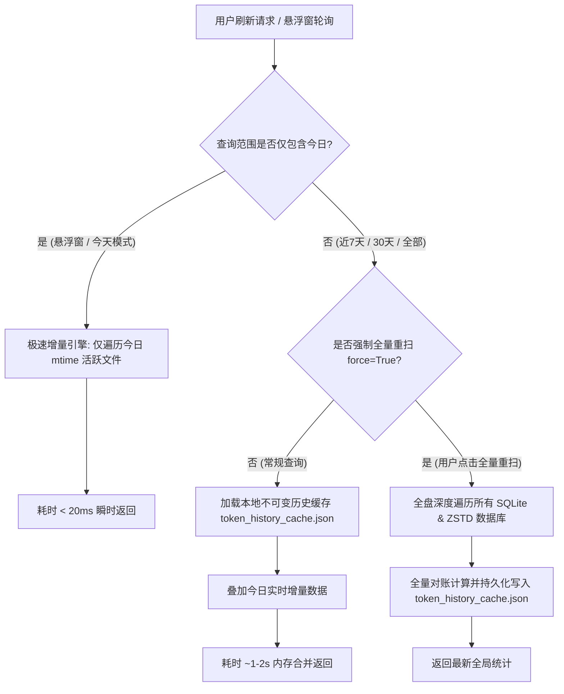

# 🪙 OmniToken

<div align="center">

**一体化本地 AI Token 与成本监控平台 (Desktop HUD & Web Analytics)**

*跨端聚合 Google Antigravity、OpenAI Codex、DeepSeek Harness 与 OpenCode 消耗流水，内置全量模型官方阶梯计价，搭载毫秒级历史缓存引擎、微信式系统托盘悬浮窗与炫酷数据大屏*

[](https://github.com/Doraawa/OmniToken/releases)
[](LICENSE)
[](https://www.python.org/)
[-0078D6.svg?style=flat-square&logo=windows&logoColor=white)](https://github.com/Doraawa/OmniToken/releases)

[✨ 核心功能](#-核心功能) • [🚀 快速开始](#-快速开始) • [⚡ 性能与历史缓存架构](#-性能与历史缓存架构) • [💰 定价模型与汇率](#-支持模型与计费规则) • [🖥️ 界面与交互](#️-界面与交互) • [⚙️ 高级配置与打包](#️-高级配置与打包)

</div>

---

## 📖 简介

在日常使用各种 AI 编程助手（如 **Google Antigravity**、**OpenAI Codex CLI**、**DeepSeek Harness** 与 **OpenCode**）时，开发者常常面临无法直观掌握当天 Token 消耗速度、难以预估 API 账单金额、缺乏全局跨平台汇总、且随着使用时间增加数据库越来越庞大导致查询刷新缓慢等痛点。

**OmniToken** 专为解决这一系列痛点而生。它无需任何云端转发或泄露本地隐私，直接在本地解析各客户端的历史记录与数据库，实时汇总四平台 Token 流水，结合官方阶梯计费模型换算为真实人民币/美元金额。凭借全新引入的**分层历史不可变数据文件缓存机制**，无论是悬浮窗 30 秒轮询还是百万级历史流水查询，均可在毫秒间瞬时完成！

---

## ✨ 核心功能

- **🔍 四源聚合无感扫描与隐私安全**
  - **Google Antigravity**：自动读取 `~/.gemini` 下各会话目录的 SQLite 数据库与 WAL 预写日志，通过物理写入与记录修改双时间戳精确校准今日与历史用量。
  - **OpenAI Codex CLI**：实时解析 `~/.codex/sessions` 的会话元数据、Zstandard 压缩流水及实时 Rate Limits 限额。
  - **DeepSeek Harness**：无缝支持 DeepSeek CLI 与 Harness 会话流水与缓存统计。
  - **OpenCode AI**：原生解析 `~/.local/share/opencode/opencode.db` SQLite 数据库，全量统计 Claude、Qwen、GLM、MiniMax 等多模型交互记录。
  - **100% 本地运行**：纯本地扫描，不上传任何对话内容或私有密钥，隐私零泄露。

- **⚡ 毫秒级历史缓存引擎（告别扫盘卡顿）**
  - **历史不可变缓存机制**：昨日及之前（< 00:00:00）的数据一经落盘永久不可变，OmniToken 自动将其持久化在本地缓存文件中。
  - **今日实时增量极速刷新**：常规刷新与悬浮窗轮询仅读取今日产生/修改的增量文件，响应时间从数秒暴降至 20ms 以内！
  - **支持一键全量深度重扫**：提供网页看板「⚡ 全量重扫缓存」按钮、悬浮窗右键「⚡ 全量重建历史缓存」以及 CLI `--force` 选项。

- **💰 精准模型官方计价引擎与统一汇率**
  - 内置最新阶梯计价标准（未缓存输入 Input、缓存命中 Cache Read、补全输出 Output 含思考推理 Thinking）。
  - 全面支持 Google Gemini 全系列（3.8 / 3.7 / 2.0 / 1.5）、OpenAI Codex 全系列（GPT-6 / GPT-5.6 / GPT-4o / o1 / o3-mini）、DeepSeek 全系列（V4 / V3 / R1）及 OpenCode 多模型。
  - **统一基准汇率 (1 USD = 7.25 CNY)**：全系统统一，真实还原境内开发者信用卡跨境结算手续费后的账单成本。

- **🪟 极简桌面 HUD 悬浮微件**
  - **纯粹无打扰**：半透明暗黑磨砂设计，置顶常驻桌面边缘，右下角拖拽把手 ⤡ 自由调大小，自动记忆位置与尺寸。
  - **任务栏静默**：不在 Windows 任务栏占据图标或标签位，保持工作区清爽。
  - **微信式系统托盘**：常驻右下角通知区域，四色能量指示柱，双击显示/隐藏，右键呼出功能菜单。

- **📊 全功能交互式 Web 大屏**
  - 内置零依赖轻量 HTTP 服务（默认端口 `8765`）。
  - 支持**今天 / 近 3 天 / 近 7 天 / 近 30 天 / 全部历史 / 自选区间**无缝切换。
  - **逐小时 / 每日趋势柱状图**（四色平台条带对比、悬浮光标高亮 Tooltip）。
  - **各模型版本消耗与官方资费明细表**、**跨引擎活跃会话排行榜 Top 15**。

---

## ⚡ 性能与历史缓存架构

随着开发工具使用时间的增长，本地累计会话可达数千个，数据库文件超数百兆，历史压缩包超数千个。若每次刷新都对磁盘进行全量暴力解压与扫表，耗时可达 5~10 秒以上。

OmniToken 采用**分层不可变历史数据缓存架构**：



- **缓存文件路径**：`~/.gemini/antigravity/token_history_cache.json`
- **今日极速增量**：利用系统文件修改时间戳（mtime）智能跳过历史旧文件，无需打开无关数据库，内存开销极低。
- **强制全量重建**：在更换数据库、删除历史会话或手动校验账目时，只需点击网页端「⚡ 全量重扫缓存」或使用 `python main.py --cli --force` 即可刷新缓存。

---

## 💰 支持模型与计费规则

### 1. 美元与人民币基准汇率 (7.25)
- **基准依据**：境内开发者在向 Google Cloud、OpenAI、Anthropic 等境外平台支付 API 费用时，通常使用国内商业银行发行的 Visa / Mastercard / 运通 双币或全币信用卡。发卡行在购汇结算时通常收取 **1.5% ~ 2.0% 的外币兑换手续费 (FTF)**，叠加即期购汇牌价差额，实际账单扣款成本汇率稳定在 **7.25** 左右。
- **系统统一**：OmniToken 的后端扫描引擎、Web 仪表盘、桌面微件以及终端 CLI 全面统一步调为 **7.25**，并支持在接口及代码中灵活动态调控。

### 2. 全量模型官方 API 计费标准表
*资费单位：美元 / 每 1,000,000 (1M) Tokens；按阶梯分别计算未缓存输入、缓存读取与生成输出。*

| 客户端平台 | 模型名称 | 未缓存输入 (Input) | 缓存命中 (Cache Read) | 补全输出 (Output/Think) | 定价特性与说明 |
| **Google Antigravity** | `Gemini 3.8 Flash` | \$0.10 | \$0.025 | \$0.40 | 次世代高速大吞吐模型 (全强度合并) |
| | `Gemini 3.7 Flash` | \$0.10 | \$0.025 | \$0.40 | 3.7 混合推理极速版 (全强度合并) |
| | `Gemini 2.0 Flash` | \$0.10 | \$0.025 | \$0.40 | 2.0 旗舰级速度与多模态 |
| | `Gemini 1.5 Flash` | \$0.075 | \$0.01875 | \$0.30 | 极高性价比通用模型 |
| | `Gemini 3.7 Pro` | \$1.25 | \$0.3125 | \$5.00 | 深度逻辑推演旗舰 |
| | `Gemini 2.0 Pro` | \$1.25 | \$0.3125 | \$5.00 | 高阶编程与长上下文 |
| | `Gemini 1.5 Pro` | \$1.25 | \$0.3125 | \$5.00 | 200万上下文长程理解 |
| **OpenAI Codex** | `gpt-6-astra` | \$5.00 | \$2.50 | \$20.00 | 高阶超大参数编程主力 |
| | `gpt-6.1-sol` | \$2.50 | \$1.25 | \$10.00 | 旗舰级智能与生成平衡 |
| | `gpt-6-sol` | \$2.50 | \$1.25 | \$10.00 | 旗舰级综合推演 |
| | `gpt-5.6-sol` | \$2.50 | \$1.25 | \$10.00 | 高度可靠的代码工程模型 |
| | `gpt-5.6-terra` | \$1.00 | \$0.50 | \$4.00 | 中轻量级任务高效模型 |
| | `gpt-6-luna` | \$0.15 | \$0.075 | \$0.60 | 极速响应轻量微调版 |
| | `gpt-5.6-luna` | \$0.15 | \$0.075 | \$0.60 | 超低时延轻量级模型 |
| | `gpt-4o` | \$2.50 | \$1.25 | \$10.00 | 全能型通用编程旗舰 |
| | `gpt-4o-mini` | \$0.15 | \$0.075 | \$0.60 | 经济型小型全能模型 |
| | `o1` (OpenAI o1) | \$15.00 | \$7.50 | \$60.00 | 强逻辑强化学习思维链模型 |
| | `o3-mini` | \$1.10 | \$0.55 | \$4.40 | 新一代 STEM / 编程推理模型 |
| **DeepSeek** | `deepseek-chat` (V3) | \$0.14 | \$0.014 | \$0.28 | 行业标杆级通用对话模型 |
| | `deepseek-flash` / `v4-flash` | \$0.14 | \$0.014 | \$0.28 | 极低缓存单价高速版 |
| | `deepseek-reasoner` (R1) | \$0.55 | \$0.14 | \$2.19 | 深度推理长思维链模型 |
| | `deepseek-r1` / `v4-pro` | \$0.55 | \$0.14 | \$2.19 | 新一代大参数深度强化版 |
| **OpenCode AI** | `claude-opus-4-7` | \$15.00 | \$3.75 | \$75.00 | 顶级架构设计与深度重构 |
| | `claude-3-7-sonnet` | \$3.00 | \$0.75 | \$15.00 | 卓越编程与思维链兼具 |
| | `claude-3-5-sonnet` | \$3.00 | \$0.75 | \$15.00 | 业界公认编程黄金基准 |
| | `qwen3.7-max` (通义千问) | \$2.50 | \$0.60 | \$10.00 | 国产超大规模逻辑旗舰 |
| | `glm-5.2` (智谱清言) | \$1.00 | \$0.20 | \$2.00 | 国产高性价比代码模型 |
| | `minimax-m3` | \$1.00 | \$0.25 | \$4.00 | 超长上下文理解模型 |

### 3. 未知或衍生模型智能启发式兜底 (Fallback Heuristics)
当遇到用户自定义或尚未收录的新模型名时，系统自动执行关键词推断：
- 模型名称包含 `flash`、`luna`、`mini`：匹配未缓存 \$0.10 / 缓存 \$0.025 / 输出 \$0.40
- 模型名称包含 `pro`、`astra`、`reasoner`、`r1`：匹配未缓存 \$2.50 / 缓存 \$0.625 / 输出 \$10.00
- 其它未收录的通用模型：默认安全兜底单价 \$1.00 / 缓存 \$0.25 / 输出 \$4.00

---

## 🚀 快速开始

### 方式一：下载 Windows 免安装便携版 (推荐)

无需安装 Python 或任何依赖，解压即用：

1. 前往 [GitHub Releases 发行页面](https://github.com/Doraawa/OmniToken/releases) 下载最新版本的 `TokenMonitor-v1.0-Windows.zip`。
2. 解压到本地任意目录（例如 `D:\Tools\OmniToken`）。
3. 双击运行 `TokenMonitor.exe`：
   - 桌面边缘自动常驻半透明 HUD 悬浮窗；
   - 任务栏右下角出现托盘图标；
   - 双击悬浮窗或右键选择“打开 Web 监控看板”，即可在浏览器中进入交互大屏。

---

### 方式二：从源码运行

如果你熟悉 Python 环境，可以直接克隆本仓库：

```bash
# 1. 克隆仓库
git clone https://github.com/Doraawa/OmniToken.git
cd OmniToken

# 2. 安装必要依赖 (仅两个极简纯图形库)
pip install -r requirements.txt
```

#### 启动选项：

- **启动桌面悬浮微件 + 后台 Web 服务** (日常推荐)：
  ```bash
  pythonw main.py
  # 或者直接双击 启动桌面悬浮窗.bat
  ```
- **仅启动 Web 监控大屏**：
  ```bash
  python main.py --web
  # 或者直接双击 启动Web看板.bat
  ```
- **在终端命令行查看报表 (CLI 模式)**：
  ```bash
  # 查看今日消耗 (毫秒级响应)
  python main.py --cli --today

  # 查看近 7 天报表
  python main.py --cli --days 7

  # 强制忽略历史缓存，全量深度重扫数据库
  python main.py --cli --force --days 30
  ```

---

## 🖥️ 界面与交互

### 1. 桌面 HUD 悬浮窗交互
| 操作 | 响应 |
| :--- | :--- |
| **鼠标左键拖拽窗口任意处** | 平滑拖拽悬浮窗至任意位置，松开后自动记忆坐标并在下次启动时恢复 |
| **右下角拖拽把手 ⤡** | 自由拉伸调整悬浮窗宽高，自动记忆尺寸 |
| **鼠标左键双击悬浮窗** | 立即呼出系统默认浏览器打开 Web 监控大屏 (`http://127.0.0.1:8765`) |
| **鼠标右键单击** | 呼出快捷菜单：最小化至托盘、立即刷新增量、⚡ 全量重建历史缓存、打开网页大屏、调整透明度、预设尺寸、开机自启等 |

### 2. 右下角系统托盘交互
- **四色能量柱图标**：托盘图标以青蓝 (AGY)、翠绿 (Codex)、亮蓝 (DeepSeek)、亮橙 (OpenCode) 实时标识。
- **悬停信息提示**：鼠标悬停在托盘图标上即可快速获知今日全机总消耗量与预估费用。
- **开机自启动**：一键设置当前用户自启快捷方式，静默后台驻留，无控制台黑框打扰。

---

## ⚙️ 高级配置与打包

### 项目结构

```text
OmniToken/
├── main.py                 # 统一主入口 (自动适配 GUI、Web、CLI 运行模式)
├── desktop_widget.pyw      # 桌面 HUD 悬浮微件 (Tkinter + PIL + Pystray 托盘)
├── app.py                  # 轻量 HTTP 服务及 CLI 命令行输出
├── token_core.py           # 核心扫描与计价引擎 (SQLite WAL 分析、Zstandard 解包、历史缓存、增量合并)
├── index.html              # 现代化 Web 数据大屏 (四平台图表、汇率换算、透视表)
├── app.ico                 # 应用程序多分辨率高清图标
├── requirements.txt        # Python 依赖清单 (Pillow, pystray)
├── 启动桌面悬浮窗.bat       # Windows 桌面后台无黑框快捷启动脚本
├── 启动Web看板.bat          # Windows 网页大屏快捷启动脚本
├── LICENSE                 # MIT 开源协议
└── README.md               # 项目使用说明
```

### 自行打包为单文件可执行程序 (.exe)

如果你对源码进行了修改并希望重新打包为独立单文件版：

```bash
# 安装 PyInstaller
pip install pyinstaller

# 一键打包命令 (无控制台窗口、内嵌 HTML 与图标资源)
pyinstaller --noconfirm --clean --windowed `
  --icon="app.ico" `
  --add-data "index.html;." `
  --add-data "app.ico;." `
  --name "TokenMonitor" `
  main.py
```

打包完成后，可在 `dist/` 目录下找到生成的 `TokenMonitor.exe`。

---

## 🤝 贡献与反馈

欢迎提交 PR 或创建 Issue！如果你在使用过程中遇到新客户端兼容需求或模型定价更新，欢迎贡献代码共同完善。

1. Fork 本仓库并新建分支 (`git checkout -b feature/AmazingFeature`)
2. 提交修改 (`git commit -m 'Add some AmazingFeature'`)
3. 推送分支 (`git push origin feature/AmazingFeature`)
4. 提交 Pull Request

---

## 📄 开源许可证

本项目采用 [MIT 许可证](LICENSE) 开源。
