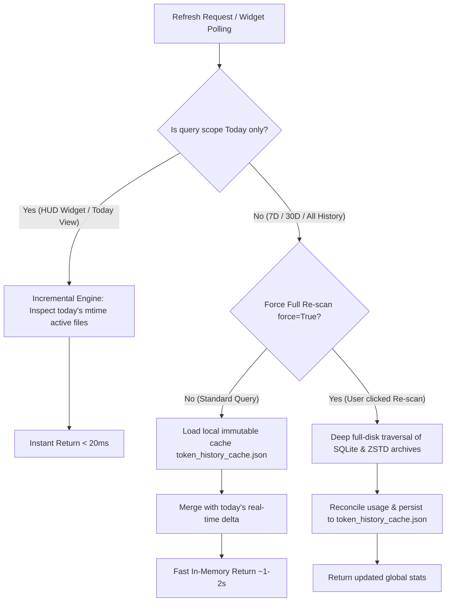

# 🪙 OmniToken

<div align="center">

**Unified Local AI Token & Cost Analytics Platform (Desktop HUD & Web Analytics)**

*Cross-platform aggregation for Google Antigravity, OpenAI Codex, DeepSeek Harness, and OpenCode AI. Built-in official tiered pricing, sub-millisecond historical caching, WeChat-style system tray HUD, and responsive interactive web dashboard.*

[](https://github.com/BeaverMakerLab/OmniToken/releases)
[](LICENSE)
[](https://www.python.org/)
[-0078D6.svg?style=flat-square&logo=windows&logoColor=white)](https://github.com/BeaverMakerLab/OmniToken/releases)

**[English](README_EN.md)** • **[简体中文](README.md)**

[✨ Key Features](#-key-features) • [🚀 Quick Start](#-quick-start) • [⚡ Cache Architecture](#-cache-architecture--performance) • [💰 Pricing & Exchange Rate](#-pricing-models--exchange-rate) • [🖥️ UI & Controls](#️-ui--controls) • [⚙️ Build & Configuration](#️-build--configuration)

</div>

---

## 📖 Introduction

Modern developers frequently leverage multiple AI programming assistants—such as **Google Antigravity**, **OpenAI Codex CLI**, **DeepSeek Harness**, and **OpenCode AI**. However, this introduces common challenges:
- Difficulty tracking real-time daily token burn rates across disparate tools;
- Unpredictable end-of-month API billing amounts;
- Lack of a unified, cross-platform aggregation view;
- Severe disk I/O and query latency as local conversation databases and compressed logs grow over time.

**OmniToken** is purpose-built to solve these problems. It runs **100% locally** with zero cloud forwarding, proxying, or credential leaks. It directly analyzes local logs, SQLite databases, and WAL records across all four platforms, computing real-time token metrics and converting them into accurate USD and CNY billing figures based on official API pricing.

With its innovative **hierarchical immutable historical caching engine**, queries—whether from a 30-second HUD polling cycle or a multi-million-token retrospective analysis—return in **under 20 milliseconds**!

---

## ✨ Key Features

- **🔍 Multi-Platform Frictionless Scanning & Privacy-First**
  - **Google Antigravity**: Scans conversation SQLite databases and WAL write-ahead logs in `~/.gemini`, applying dual-timestamp calibration for physical and logical updates.
  - **OpenAI Codex CLI**: Streams conversation metadata, Zstandard (`.zst`) compressed session events, and real-time rate limit tokens from `~/.codex/sessions`.
  - **DeepSeek Harness**: Natively monitors DeepSeek CLI and Harness session streams and prompt cache hit rates.
  - **OpenCode AI**: Queries `~/.local/share/opencode/opencode.db` to aggregate usage across Claude, Qwen, GLM, MiniMax, and custom endpoints.
  - **100% Local & Secure**: Zero network transmission of prompt content, code, or API keys. Your privacy is strictly preserved.

- **⚡ Sub-Millisecond Historical Cache Engine**
  - **Immutable History Caching**: Data from yesterday and earlier (`< 00:00:00`) is treated as permanently immutable once finalized and persisted locally.
  - **Instant Daily Incremental Scan**: Regular polling and desktop HUD refreshes only inspect files modified today, reducing disk scan times from several seconds to **< 20ms**.
  - **One-Click Deep Re-scan**: Supports full cache rebuilds via the Web dashboard's **"⚡ Re-scan Cache"** button, the desktop widget's context menu, or CLI `--force`.
  - **Independent Standard Path**: Persisted at `~/.omnitoken/token_history_cache.json` with seamless automatic backward migration for legacy paths.

- **💰 Accurate Official Tiered Pricing & Realistic Exchange Rate**
  - Granularly distinguishes **Uncached Input**, **Cached Input (Cache Read)**, and **Output (including Reasoning / Thinking Tokens)**.
  - Comprehensive out-of-the-box support for Google Gemini (3.8 / 3.7 / 2.0 / 1.5), OpenAI Codex (GPT-6 / GPT-5.6 / GPT-4o / o1 / o3-mini), DeepSeek (V4 / V3 / R1), and OpenCode multi-model routing.
  - **Unified Real-World Exchange Rate (1 USD = 7.25 CNY)**: Uniformly applied across backend engines, CLI, HUD, and Web UI, accurately accounting for cross-border credit card Foreign Transaction Fees (FTF).

- **🪟 Minimalist Desktop HUD Floating Widget**
  - **Non-Intrusive Aesthetic**: Translucent frosted-glass dark theme, always-on-top edge docking, corner handle ⤡ for free resizing, with automatic position and geometry memory.
  - **Taskbar Silent**: Does not clutter the Windows taskbar with window icons or labels.
  - **WeChat-Style System Tray**: Four-color energy bar icon in the system notification area, double-click to toggle, hover for daily consumption tooltip, right-click for quick actions.

- **📊 Full-Featured Interactive Web Analytics Dashboard**
  - Built-in zero-dependency HTTP server (default port `8765`).
  - Seamless timeframe filtering: **Today / Last 3 Days / Last 7 Days / Last 30 Days / All History / Custom Date Range**.
  - **Hourly and Daily Trend Charts** with 4-engine stacked color ribbons and cursor hover tooltips.
  - **Model Breakdown Table** with unit pricing and **Top 15 Active Sessions Leaderboard**.

---

## ⚡ Cache Architecture & Performance

As development tools accumulate thousands of historical sessions, databases and compressed archives can swell to hundreds of megabytes. Running full disk traversals and decompression on every refresh creates unacceptable 5–10s freezing delays.

OmniToken employs a **hierarchical immutable caching pipeline**:



- **Cache File Path**: `~/.omnitoken/token_history_cache.json` (dedicated directory, automatically migrates legacy paths).
- **Fast Daily Incremental Engine**: Uses filesystem modification timestamps (`mtime`) to skip unchanged historical archives without loading databases into memory.
- **On-Demand Cache Rebuilding**: Available via the Web UI button, tray icon menu, or `python main.py --cli --force`.

---

## 💰 Pricing Models & Exchange Rate

### 1. Benchmark Exchange Rate (1 USD = 7.25 CNY)
- **Rationale**: When paying overseas API invoices (Google Cloud, OpenAI, Anthropic, etc.), domestic developers typically use dual-currency or multi-currency credit cards. Card issuers typically assess a **1.5% to 2.0% Foreign Transaction Fee (FTF)** on top of spot forex rates, bringing actual billing costs to approximately **7.25 CNY per USD**.
- **System-Wide Consistency**: Applied across the backend calculation engine, desktop HUD, Web analytics, and terminal CLI.

### 2. Official Model API Pricing Rate Card
*Prices in USD per 1,000,000 (1M) Tokens. Calculated by tiered rates for Uncached Input, Cache Read, and Output/Thinking.*

| Platform | Model Name | Uncached Input | Cache Read | Output (incl. Thinking) | Notes & Highlights |
| :--- | :--- | :---: | :---: | :---: | :--- |
| **Google Antigravity** | `Gemini 4 Argon` | \$2.00 | \$0.10 | \$10.00 | Next-gen frontier reasoning flagship (launch promo) |
| | `Gemini 3.8 Pro` | \$1.25 | \$0.3125 | \$5.00 | 3.8 top-tier deep reasoning & architecture |
| | `Gemini 3.8 Flash` | \$0.10 | \$0.025 | \$0.40 | Next-gen high-throughput flagship (all thinking budgets) |
| | `Gemini 3.7 Flash` | \$0.10 | \$0.025 | \$0.40 | 3.7 hybrid reasoning speed edition |
| | `Gemini 2.0 Flash` | \$0.10 | \$0.025 | \$0.40 | 2.0 multimodal speed flagship |
| | `Gemini 1.5 Flash` | \$0.075 | \$0.01875 | \$0.30 | High efficiency lightweight model |
| | `Gemini 3.7 Pro` | \$1.25 | \$0.3125 | \$5.00 | Deep reasoning & coding flagship |
| | `Gemini 2.0 Pro` | \$1.25 | \$0.3125 | \$5.00 | Advanced code & logic model |
| | `Gemini 1.5 Pro` | \$1.25 | \$0.3125 | \$5.00 | 2M context long-horizon understanding |
| **OpenAI Codex** | `gpt-6-astra` | \$5.00 | \$2.50 | \$20.00 | Advanced large-parameter coding flagship |
| | `gpt-6.1-sol` | \$2.50 | \$1.25 | \$10.00 | Flagship intelligence & balanced generation |
| | `gpt-6-sol` | \$2.50 | \$1.25 | \$10.00 | Flagship general reasoning |
| | `gpt-5.6-sol` | \$2.50 | \$1.25 | \$10.00 | Highly reliable software engineering model |
| | `gpt-5.6-terra` | \$1.00 | \$0.50 | \$4.00 | Balanced efficiency workhorse |
| | `gpt-6-luna` | \$0.15 | \$0.075 | \$0.60 | Ultra-fast lightweight response model |
| | `gpt-5.6-luna` | \$0.15 | \$0.075 | \$0.60 | Low-latency lightweight model |
| | `gpt-4o` | \$2.50 | \$1.25 | \$10.00 | Versatile general coding flagship |
| | `gpt-4o-mini` | \$0.15 | \$0.075 | \$0.60 | High-efficiency small model |
| | `o1` (OpenAI o1) | \$15.00 | \$7.50 | \$60.00 | Deep RL chain-of-thought reasoning |
| | `o3-mini` | \$1.10 | \$0.55 | \$4.40 | STEM & competitive coding reasoning model |
| **DeepSeek** | `deepseek-chat` (V3) | \$0.14 | \$0.014 | \$0.28 | Industry benchmark general dialogue |
| | `deepseek-flash` / `v4-flash` | \$0.14 | \$0.014 | \$0.28 | Ultra-low cache pricing speed model |
| | `deepseek-reasoner` (R1) | \$0.55 | \$0.14 | \$2.19 | Open reasoning long chain-of-thought |
| | `deepseek-r1` / `v4-pro` | \$0.55 | \$0.14 | \$2.19 | Next-gen large-parameter reasoning |
| **Anthropic Claude** | `Claude Fable 5.1` | \$10.00 | \$0.25 | \$50.00 | 5.1 Top-tier reasoning/agentic flagship (low cache read) |
| | `Claude Fable 5` | \$10.00 | \$1.00 | \$50.00 | Generation 5 deep reasoning agent model |
| | `Claude Opus 5.5` | \$4.00 | \$0.20 | \$20.00 | 5.5 High-efficiency architecture & code flagship |
| | `Claude Opus 5` | \$5.00 | \$0.50 | \$25.00 | Generation 5 long-horizon knowledge & refactoring |
| | `Claude Opus 4.7` / `3 Opus` | \$15.00 | \$1.50 | \$75.00 | Classic premier deep reasoning flagship |
| | `Claude Sonnet 5.5` | \$2.00 | \$0.10 | \$10.00 | 5.5 Next-gen balanced software engineering workhorse |
| | `Claude 3.7 Sonnet` | \$3.00 | \$0.30 | \$15.00 | Hybrid thinking & software development flagship |
| | `Claude 3.5 Sonnet` | \$3.00 | \$0.30 | \$15.00 | Industry gold-standard coding benchmark |
| | `Claude Haiku 5.5` | \$0.10 | \$0.01 | \$0.50 | 5.5 Ultra-high throughput & lowest cost |
| | `Claude 3.5 Haiku` | \$0.80 | \$0.08 | \$4.00 | High-efficiency responsive lightweight model |
| | `Claude 3 Haiku` | \$0.25 | \$0.025 | \$1.25 | Classic fast lightweight workhorse |
| **OpenCode / Domestic Flagships** | `qwen3.7-max` (Tongyi) | \$2.50 | \$0.60 | \$10.00 | Flagship large-scale logic model |
| | `glm-5.2` (Zhipu) | \$1.00 | \$0.20 | \$2.00 | High-performance cost-effective coding model |
| | `minimax-m3` | \$1.00 | \$0.25 | \$4.00 | Long-context understanding model |

### 3. Fallback Heuristics for Custom Models
When encountering unlisted or custom fine-tuned model identifiers, the system infers tier pricing automatically:
- Names containing `fable`: \$10.00 Uncached / \$0.25 Cached / \$50.00 Output
- Names containing `opus`: \$4.00 ~ \$15.00 tier (default fallback \$5.00 Uncached / \$0.50 Cached / \$25.00 Output)
- Names containing `sonnet`: \$2.00 ~ \$3.00 tier (default fallback \$3.00 Uncached / \$0.30 Cached / \$15.00 Output)
- Names containing `haiku`: \$0.10 ~ \$0.80 tier (default fallback \$0.80 Uncached / \$0.08 Cached / \$4.00 Output)
- Names containing `argon`: \$2.00 Uncached / \$0.10 Cached / \$10.00 Output
- Names containing `flash`, `luna`, `mini`: \$0.10 Uncached / \$0.025 Cached / \$0.40 Output
- Names containing `pro`, `astra`, `reasoner`, `r1`: \$2.50 Uncached / \$0.625 Cached / \$10.00 Output
- Unrecognized models: Safe default of \$1.00 Uncached / \$0.25 Cached / \$4.00 Output

---

## 🚀 Quick Start

### Option 1: Standalone Windows Portable Release (Recommended)

No Python installation required. Unpack and run immediately:

1. Download `TokenMonitor-v1.0-Windows.zip` from [GitHub Releases](https://github.com/BeaverMakerLab/OmniToken/releases).
2. Extract to any local folder (e.g., `D:\Tools\OmniToken`).
3. Double-click `TokenMonitor.exe`:
   - A translucent floating HUD appears at your desktop edge;
   - A 4-color energy icon appears in your system tray;
   - Double-click the widget or right-click "Open Web Analytics" to view the browser dashboard.

---

### Option 2: Run from Python Source

If you prefer running from source in a Python environment:

```bash
# 1. Clone the repository
git clone https://github.com/BeaverMakerLab/OmniToken.git
cd OmniToken

# 2. Install minimal dependencies (pure GUI libraries only)
pip install -r requirements.txt
```

#### Launch Modes:

- **Desktop HUD Widget + Background Web Server** (Standard):
  ```bash
  pythonw main.py
  # Or double-click: 启动桌面悬浮窗.bat
  ```
- **Web Analytics Dashboard Only**:
  ```bash
  python main.py --web
  # Or double-click: 启动Web看板.bat
  ```
- **Terminal CLI Report Mode**:
  ```bash
  # Check today's usage (< 20ms response)
  python main.py --cli --today

  # Check last 7 days report
  python main.py --cli --days 7

  # Force deep re-scan bypassing historical cache
  python main.py --cli --force --days 30
  ```

---

## 🖥️ UI & Controls

### 1. Desktop HUD Floating Widget
| Action | Response |
| :--- | :--- |
| **Left-drag anywhere on window** | Smoothly move the HUD widget. Position is automatically remembered for the next launch. |
| **Drag corner handle ⤡** | Freely resize widget width and height with automatic geometry retention. |
| **Double-click left mouse button** | Automatically opens the Web analytics dashboard (`http://127.0.0.1:8765`) in your default browser. |
| **Right-click window** | Context menu: Minimize to Tray, Incremental Refresh, ⚡ Full Cache Rebuild, Open Web Dashboard, Opacity Slider, Window Presets, Launch on Startup. |

### 2. System Tray Icon
- **4-Color Energy Column**: Real-time indicators for Antigravity (Cyan), Codex (Emerald), DeepSeek (Blue), and OpenCode (Orange).
- **Hover Tooltip**: Instantly view today's total machine-wide tokens and estimated billing.
- **Run on Startup**: One-click toggle to create a current-user startup shortcut, silent in the background with no console window.

---

## ⚙️ Build & Configuration

### Directory Structure

```text
OmniToken/
├── main.py                 # Unified main entry point (GUI, Web, and CLI modes)
├── desktop_widget.pyw      # Desktop HUD floating widget (Tkinter + PIL + Pystray)
├── app.py                  # Lightweight HTTP server & CLI formatter
├── token_core.py           # Core scanning & pricing engine (SQLite WAL, Zstandard, caching, incremental merge)
├── index.html              # Modern Web analytics dashboard (charts, currency toggles, pivot tables)
├── app.ico                 # Multi-resolution high-DPI application icon
├── requirements.txt        # Minimal Python dependencies (Pillow, pystray)
├── LICENSE                 # MIT License
├── README.md               # Chinese Documentation
└── README_EN.md            # English Documentation
```

### Building Standalone Executable (.exe)

To build the self-contained portable Windows binary using PyInstaller:

```bash
# Install PyInstaller
pip install pyinstaller

# Build command (windowed, embedded HTML and icon)
pyinstaller --noconfirm --clean --windowed `
  --icon="app.ico" `
  --add-data "index.html;." `
  --add-data "app.ico;." `
  --name "TokenMonitor" `
  main.py
```

The resulting `TokenMonitor.exe` will be located in the `dist/` directory.

---

## 🤝 Contributing & Feedback

Contributions, issues, and feature requests are welcome! If you notice new AI client storage locations or updated model pricing tiers, feel free to submit a pull request.

1. Fork this repository and create your feature branch (`git checkout -b feature/AmazingFeature`)
2. Commit your changes (`git commit -m 'Add some AmazingFeature'`)
3. Push to the branch (`git push origin feature/AmazingFeature`)
4. Open a Pull Request

---

## 📄 License

This project is licensed under the [MIT License](LICENSE).
